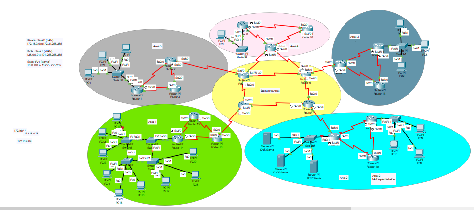
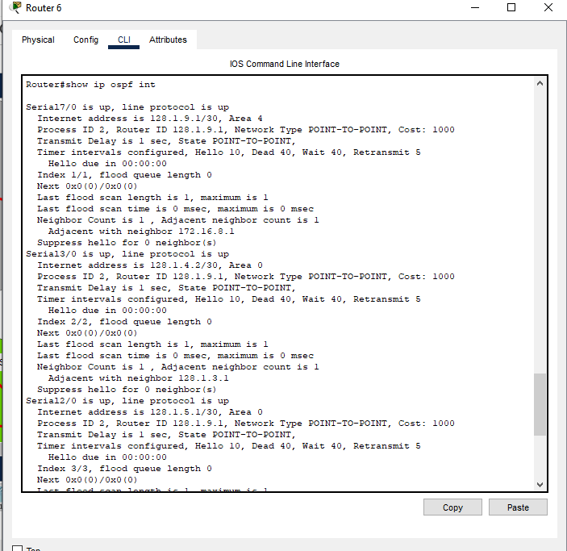
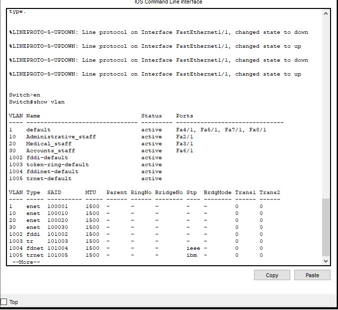
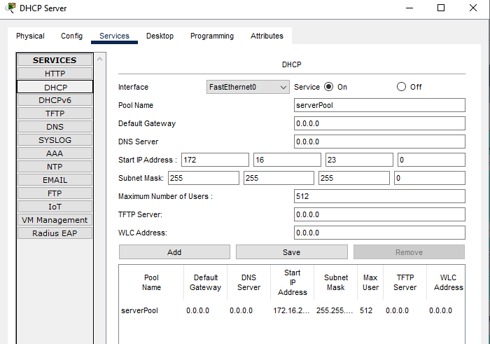
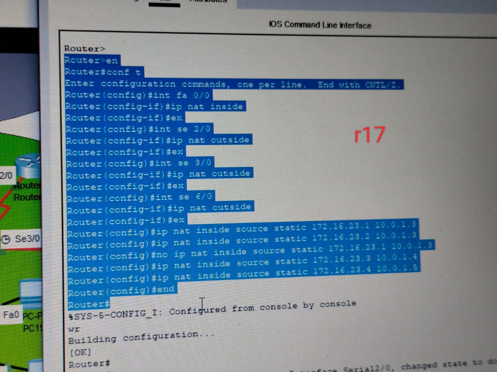
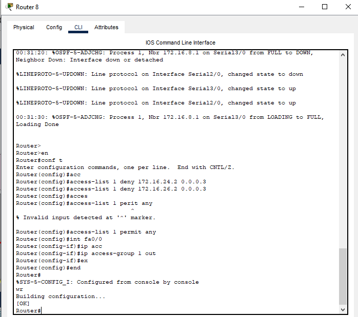
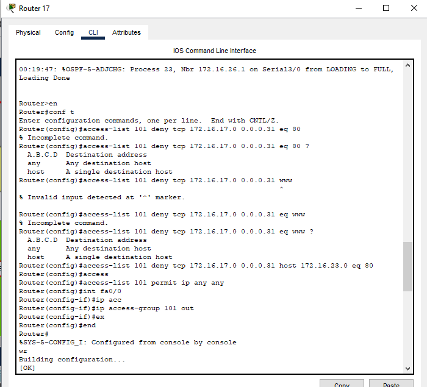
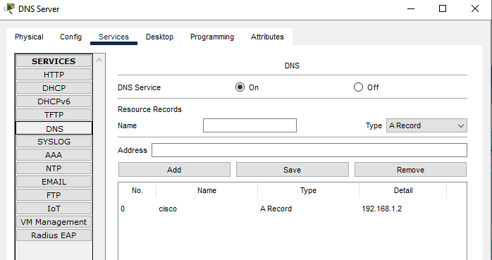
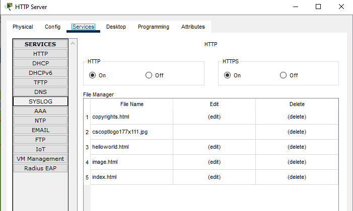

# hospital-network-ospf

Network design for a hospital campus (from the assignment brief), built in Cisco Packet Tracer for the Data Communication & Computer Networks CEP at COMSATS Lahore. Solo project.

## What's configured

- **Multi-area OSPF:** a backbone (Area 0) plus 5 areas, with ABRs summarising routes into the backbone to cut routing overhead. WAN links have different bandwidths so OSPF costs actually differ. Path costs were worked out for 5 routes.
- **Addressing:** public Class B (128.x) on WAN links, private Class B (172.16–31.x) on LANs, and static 10.x for servers.
- **Area 1 VLANs:** admin, medical and accounts staff separated on the same switches.
- **Area 2 services:** DHCP server for every host in the network (via `ip helper-address` relays), DNS + HTTP so the site opens by URL, and static NAT so the servers can't be reached on their private IPs.
- **ACLs:**
  - Area 3 is closed to unauthorised traffic.
  - Area 5 can't reach the web server.
  - The LAN behind Router 18 can't reach PC1's network in Area 4.

| | |
|---|---|
|  |  |
|  |  |
|  |  |
|  |  |

## Open it

Install Cisco Packet Tracer (8.x) and open `hospital_network.pkt`. `show ip ospf neighbor`, `show ip route` and `show ip nat translations` on the routers are the quickest way to see it working.
